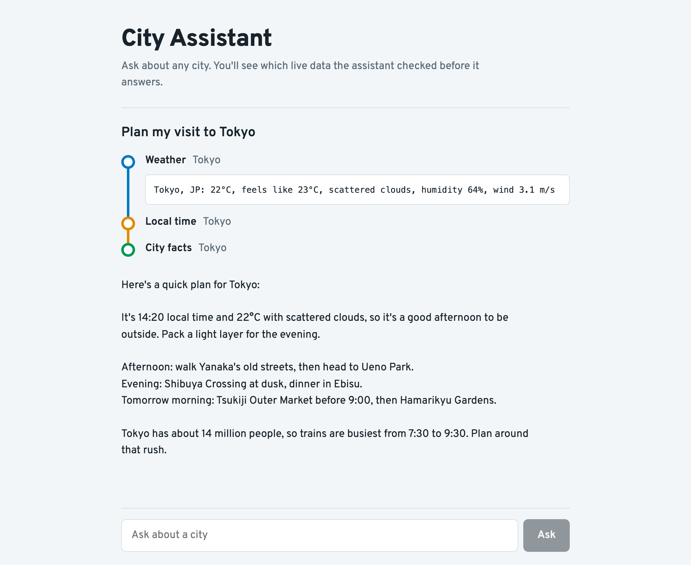

# City Assistant

[](https://github.com/hiteshkalwani/city-assistant/actions/workflows/ci.yml)


An LLM agent that answers questions about any city: live weather, local time, facts, and a full visit plan. An OpenAI tool-calling agent decides which tools to call. Results are cached in Redis and served by three FastAPI replicas behind nginx, with a React UI that shows each tool call as a stop on the route to the answer.

<picture>
  <source media="(prefers-color-scheme: dark)" srcset="docs/screenshots/chat-dark.png" />
  
</picture>

<sub>Screenshot of the real UI and API, with the LLM response stubbed so it can be reproduced without an OpenAI key.</sub>

The API on its own:

```bash
curl -s localhost/api/v1/chat -H 'Content-Type: application/json' \
  -d '{"messages":[{"role":"user","content":"Plan my visit to Tokyo"}]}'
```

```json
{
  "message":   {"role": "assistant", "content": "Here's your Tokyo plan..."},
  "thinking":  "I'm analyzing your request: 'Plan my visit to Tokyo'. Planning a comprehensive visit to Tokyo by combining weather, time, and city information.",
  "tool_calls": [{"tool": "plan_city_visit", "input": {"city": "Tokyo"}, "output": "..."}],
  "usage":     {"prompt_tokens": 812, "completion_tokens": 240, "total_tokens": 1052}
}
```

## Quick start

```bash
cp .env.example .env      # set OPENAI_API_KEY; weather/geo keys are optional
make up                   # UI + API on http://localhost (nginx, 3 backend replicas, redis)
open http://localhost      # API docs at http://localhost/docs
```

Without Docker:

```bash
make install
cd backend && uvicorn app.main:app --reload   # API on http://localhost:8000
make ui                                       # UI on http://localhost:5173, proxies /api
```

## API

| Method | Path | Purpose |
|---|---|---|
| `POST` | `/api/v1/chat` | Chat. Optional `city`, `country`, `temperature`, `max_tokens`, and `stream: true` for SSE |
| `GET` | `/api/v1/chat/stream?message=...` | Same, as server-sent events (`start` → `tool_call`* → `token`* → `complete`) |
| `GET` | `/health` | Liveness (no external calls) |
| `GET` | `/api/v1/health` | Readiness, including Redis and upstream APIs |

Message roles are validated (`user`, `assistant`, `system`). Earlier messages are passed to the agent as conversation history.

## How it's built

See **[docs/ARCHITECTURE.md](docs/ARCHITECTURE.md)** for the request flow, design decisions and known limitations, and **[docs/PRD.md](docs/PRD.md)** for the product requirements.

- **React + TypeScript (Vite)** single-page UI that reads the SSE stream with `fetch`, so it can POST the whole conversation
- **FastAPI + Pydantic** for validation at the edge
- **LangChain `AgentExecutor`** with four tools; `plan_city_visit` composes the other three
- **Redis** cache shared by replicas, TTL per tool, skipped if Redis is down
- **nginx** with least-connections balancing, rate limiting (10 r/s API, 5 r/s streaming) and gzip
- **LangSmith** tracing (optional, `LANGCHAIN_TRACING_V2=true`)

## Development

```bash
make test    # backend (145) + frontend tests, no API keys or network needed
make lint    # ruff
```

CI (GitHub Actions) runs backend lint and tests with coverage, the frontend tests and type-checked build, and both Docker builds on every push and PR.

```
.
├── backend/
│   ├── app/
│   │   ├── api/v1/      # HTTP layer: chat (JSON + SSE), health
│   │   ├── agents/      # CityInformationAgent: prompt + tools + executor
│   │   ├── tools/       # weather, time, facts, plan_city_visit
│   │   ├── core/        # settings, logging, redis, cache decorator, tracing
│   │   └── utils/       # http client, exceptions
│   ├── tests/
│   ├── Dockerfile
│   ├── pyproject.toml   # pytest + ruff config
│   └── requirements*.txt
├── frontend/
│   ├── src/             # App.tsx (chat + route), chat.ts (SSE client) + tests
│   └── Dockerfile       # builds the UI into the nginx image
├── nginx/nginx.conf     # serves the UI, proxies /api, unbuffered SSE
├── docs/                # architecture, PRD, screenshots
├── docker-compose.yml
└── Makefile
```

## License

MIT. See [LICENSE](LICENSE).
